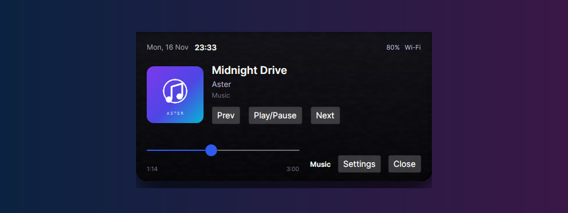
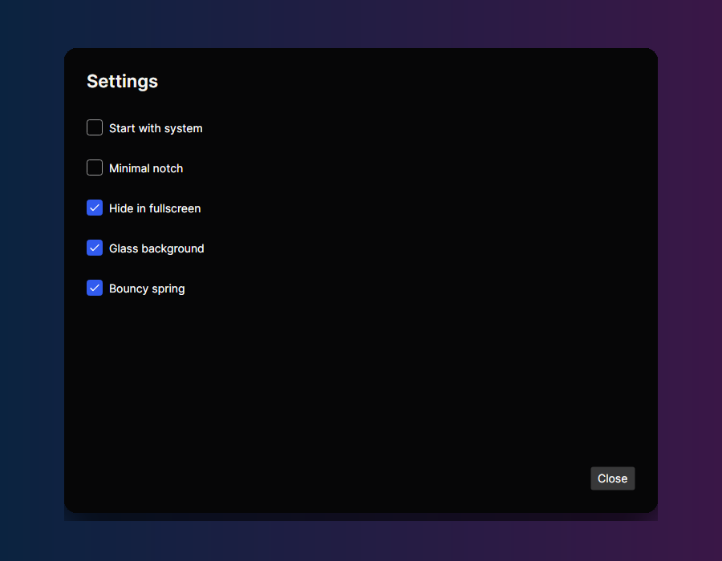

# Aster

A tiny island for your desktop. Aster is a compact, always-on-top media
island for Windows and Linux, built with **C# / Avalonia (.NET 10)** and
published as a NativeAOT portable preview.


> **Portable preview (v0.11.0).** This release ships the Avalonia L2 shell.
> The older WPF application under `src/DynamicIsland` remains in the
> repository as a legacy baseline and is not part of this release.

## Preview

<p align="center">
  
</p>

<p align="center">
  
</p>

## What is in this release

- Compact pill with clock, battery, Wi-Fi, and now-playing.
- Expanded media panel with artwork, title, artist, source,
  previous/play-pause/next, seek, settings, and close.
- Windows: SMTC media session.
- Linux: MPRIS media session (X11/XWayland).
- Settings: autostart, minimal notch, hide in fullscreen, glass, bouncy.
- Tray: show/hide, start with system, settings, quit.
- Single instance.
- NativeAOT portable archives.

Not in this release: camera, file shelf, focus timer, water reminder, lyrics,
volume/brightness overlays, and mascot. Those features exist only in the
legacy WPF app.

## Download and run

Download the archive for your platform from GitHub Releases:

- `Aster-0.11.0-win-x64.zip`
- `Aster-0.11.0-linux-x64.tar.gz`

### Windows

1. Extract the zip.
2. Run `Aster.exe`.
3. Keep `av_libglesv2.dll`, `libSkiaSharp.dll`, and `libHarfBuzzSharp.dll`
   next to `Aster.exe`; the app will not start without them.
4. SmartScreen will warn because the binary is not signed. Choose
   **More info → Run anyway**.
5. Settings live in `%LOCALAPPDATA%\AsterLab\Avalonia`.

Requires Windows 10 version 2004 (build 19041) or later.

### Linux

1. Extract the tarball.
2. Run `./Aster`.
3. Keep `libSkiaSharp.so` and `libHarfBuzzSharp.so` next to `Aster`.
4. Settings live in `~/.local/share/AsterLab/Avalonia`.

Requires an X11 or XWayland session (KDE Plasma is the validated desktop),
glibc 2.39+, libicu, and the X11 libraries. The tray uses
StatusNotifierItem; KDE provides it. GNOME needs an extension and is not part
of the validated matrix. MPRIS controls require an MPRIS-capable player.

Autostart records the current executable path. If you move the folder, turn
autostart off and on again.

## Feature matrix

| Feature | Windows | Linux | Notes |
|---|---|---|---|
| Compact pill (clock, battery, Wi-Fi, media) | Yes | Yes | |
| Expanded media + controls + seek | Yes | Yes | Windows SMTC / Linux MPRIS |
| Settings window | Yes | Yes | autostart, minimal notch, fullscreen hide, glass, bouncy |
| Tray | Yes | Yes | KDE SNI validated |
| Start with OS | Yes | Yes | adapter present on both; Linux UI toggle verified in R-07; Windows UI toggle NOT RUN |
| Single instance | Yes | Yes | |
| Camera, shelf, focus, water, lyrics, overlays, mascot | No | No | WPF-only, not in this release |

## Build from source

Prerequisites: .NET 10 SDK. The repository pins `10.0.404` in `global.json`.

```bash
dotnet build src/Aster.Avalonia/Aster.Avalonia.sln -c Release -p:EnableWindowsTargeting=true
dotnet test src/Aster.Avalonia/Aster.Core.Tests/Aster.Core.Tests.csproj -c Release
dotnet test src/Aster.Avalonia/Aster.UI.Tests/Aster.UI.Tests.csproj -c Release
dotnet test src/Aster.Avalonia/Aster.Platform.Linux.Tests/Aster.Platform.Linux.Tests.csproj -c Release
```

Linux AOT and probes:

```bash
scripts/test-aot-linux.sh
scripts/verify-phase2.sh
```

`scripts/test-aot-linux.sh` expects the SDK under `$HOME/.dotnet`; set
`DOTNET_ROOT`/`PATH` or install the SDK there before running it.

Packaging:

```bash
scripts/package-linux.sh 0.11.0 artifacts/release
```

```powershell
powershell -ExecutionPolicy Bypass -File scripts/package-windows.ps1 -Version 0.11.0 -Output artifacts/release
```

## Verification status

This is a portable preview. The public summary is in the release notes.
Windows 2A manual gates are not run in the release session; Linux
click-through at 125/150/200% remains partial; the Linux 60-minute soak and
Orca walkthrough are not run. GNOME/Ubuntu and pure X11 are not run, macOS is
deferred, WPF settings are not migrated automatically, the AOT toolchain
still needs a standard distro install, and the WPF regression build is not
run. Do not read this release as “L2 PASS”.

## Legacy WPF baseline

`src/DynamicIsland` is the earlier WPF implementation. It targets
`net8.0-windows` and still contains the full old feature set (camera, shelf,
focus, water, lyrics, overlays, mascot). It is not part of the portable
release. The repository-pinned .NET 10 SDK is the SDK authority; the WPF
project still targets .NET 8 and may require the .NET 8 targeting pack.

```powershell
dotnet build src/DynamicIsland/DynamicIsland.csproj -c Debug
dotnet publish src/DynamicIsland/DynamicIsland.csproj -c Release -r win-x64 --self-contained true -p:PublishSingleFile=true -p:IncludeNativeLibrariesForSelfExtract=true -p:EnableCompressionInSingleFile=true -o dist
```

## License

MIT — see [LICENSE](LICENSE).
